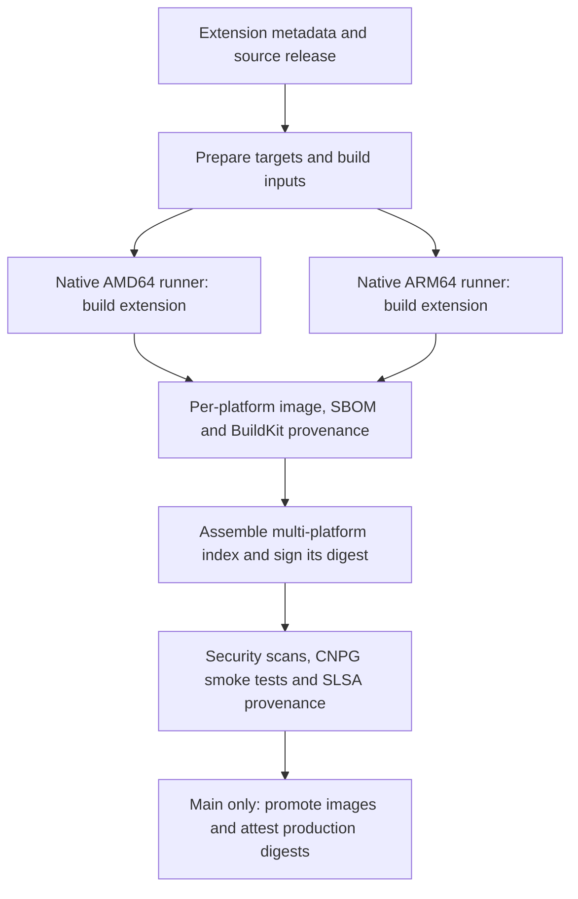

# PGRX extension builds

This project builds Rust-based PostgreSQL extensions from source using PGRX.
Each published image supports AMD64 and ARM64 and includes a software bill of
materials (SBOM), build provenance, and original license notices. Rust compilation
runs on native hardware for each architecture.

To use an extension in CloudNativePG, start with that extension's README for
installation, SQL names, and preload settings. This guide explains how to verify
its image, test a build, and maintain its build recipe.

## Usage

PGRX images use the same SBOM and verification tools as the project's Debian-built
extensions. Their SBOMs also include the Rust dependency graph selected for the
extension. You do not need Rust, cargo-pgrx, or the build tools to inspect a
published image. Scan the PostgreSQL base image separately using its own SBOM.

### Verify images

Follow the SBOM guide to [verify the image and extract its
SBOM](../sbom-generator/README.md#verify-the-image-and-extract-its-sbom),
[inspect and verify build provenance](../sbom-generator/README.md#inspect-and-verify-build-provenance),
and [report vulnerabilities and licenses](../sbom-generator/README.md#report-vulnerabilities-and-licenses).
The tools listed in that guide are sufficient; no PGRX build setup is needed.

For PGRX images published by `cnpg-extensions` from `main`, use this exact
`--certificate-identity` in the guide's Cosign command:

```text
https://github.com/cnpg-extensions/postgres-extensions-containers/.github/workflows/pgrx_targets.yml@refs/heads/main
```

Keep the guide's GitHub Actions OIDC issuer and add
`--new-bundle-format=false` for this repository's legacy-format signatures.
For another publisher, change both the image repository and the exact workflow
identity to that publisher's repository and trusted branch. After copying an
image, verify the destination repository's signature as well.

The guide's extraction examples use a multi-platform index. For a
single-platform index, confirm its platform with `docker buildx imagetools
inspect`, then use `.SBOM.SPDX` and `.Provenance.SLSA` in the format expressions.

PGRX Cargo relationships describe the configured target dependency graph; they
do not claim that every dependency survives linker dead-code elimination.

## How images are built

An extension's `metadata.hcl` selects its source version, PostgreSQL versions,
and distributions. Preparation turns those choices into a build plan. Each
**target** is one distribution/PostgreSQL combination; each target gets a
separate build job for AMD64 and ARM64.



Each native build uses the extension's upstream build recipe, collects Cargo and
license evidence, and copies the extension's runtime files into a minimal
`scratch` image. The shared [SBOM generator](../sbom-generator/README.md#development)
uses the builder and final filesystem to describe what ships. A PGRX hook adds
the selected Rust packages and their license information to the same SPDX 2.3
document. BuildKit attaches the SBOM and build provenance to the platform image.

Assembly combines the platform images and their attestations without rebuilding
Rust code. It checks that both platforms are present and that all their image
and attestation descriptors survive unchanged. Signing and later checks use
immutable image digests, so they refer to the assembled output.

Branch builds publish testing images. Production promotion is restricted to
trusted `main` push or dispatch events and requires security, smoke, signing,
and SLSA stages to succeed. Grype reports vulnerabilities and Grant reports
licenses; findings are retained for review, while scanner errors fail the job.

## Development

### Test a complete extension build

For full extension acceptance, dispatch
[`.github/workflows/pgrx.yml`](../.github/workflows/pgrx.yml) with an
`extension_name`. It builds all targets declared in the extension's metadata on
native AMD64 and ARM64 runners, assembles and signs their indexes, checks
SPDX/Grype/Grant results, and runs CNPG smoke tests. An optional `cnpg_version`
selects `main` or a full version such as `1.30.1`; otherwise the shared support
policy selects the smoke versions. No local signing keys are needed.

Both build families use the shared [smoke workflow](../.github/workflows/smoke.yml)
and test the same CNPG versions: `main`, the highest stable patch of the previous
minor, and the pinned latest release. Smoke uses the standard Task/Dagger setup,
CNPG extension catalogs, and extension installation checks. PGRX supplies the
assembled image digest and selected CNPG release directly. The shared Taskfile
uses live operator manifests and catalogs, including development images for
`main`.

### Try an unsigned local build

Use the extension's ordinary Bake targets with
`-f docker-bake.hcl -f docker-bake-pgrx.hcl -f <extension>/metadata.hcl`
in that order. Supply `build_timestamp` and the digest-qualified `sbom_generator`
from preparation. Select explicit named Bake targets to build a single local
distribution, and restrict the platform to your host's native architecture
(for example, `--set '*.platforms=linux/amd64'` on AMD64). Do not emulate the
other architecture for a Rust build.

The diagnostic `pgrx-sbom` target exports Cargo evidence for inspection. It does
not replace an image build that produces attestations or test hosted signing.

### Local validation

The dedicated [PGRX test workflow](../.github/workflows/pgrx-tests.yml) runs
independently of Go tests. It does not replace the shared Automerge gate or
change branch protection.

Run from the repository root with actionlint and Python available. The Python
tests also run Syft against fixture lockfiles and require the SPDX validator.
Docker is needed for the tool extraction below.

Create and activate a virtual environment for SPDX validation, then copy Syft
from the same pinned generator used by the workflow:

```sh
python3 -m venv /tmp/cnpg-pgrx-venv
source /tmp/cnpg-pgrx-venv/bin/activate
spdx_tools_version=$(sed -n 's/^ARG SPDX_TOOLS_VERSION=//p' sbom-generator/Dockerfile)
test -n "$spdx_tools_version"
python -m pip install "spdx-tools==${spdx_tools_version}"
generator=$(sed -n 's/^ *SBOM_GENERATOR: //p' .github/workflows/pgrx_targets.yml)
test -n "$generator"
syft_container=$(docker create "$generator")
docker cp "$syft_container:/usr/local/bin/syft" "$VIRTUAL_ENV/bin/syft"
docker rm "$syft_container"
```

Run the PGRX tests and relevant workflow lint:

```sh
python3 pgrx/test.py && \
  actionlint .github/workflows/pgrx.yml \
    .github/workflows/pgrx_targets.yml \
    .github/workflows/pgrx-tests.yml \
    .github/workflows/cnpg-versions.yml \
    .github/workflows/smoke.yml
```

Shared Go and SBOM-generator suites have their own workflows. Run them separately
when changing shared code or an integration boundary. PGRX tests retain coverage
for Rust package selection, licenses, ownership, shipped files, generator/hook
composition, build selection, and native-platform assembly.
SBOM tests focus on mistakes that can produce a successful build with an
incorrect inventory, ownership, dependency graph, or license report. Malformed
evidence and other inputs that already cause a clear build failure rely on the
build-time guards rather than separate rejection tests.

After setup, `python3 pgrx/test.py` runs just the downstream suite. CI runs it
inside the pinned generator image so Syft and the SPDX validator match the
production hook environment. The generator's
BuildKit/SPDX/Grype/Grant integration fixture is maintained in
`sbom-generator/tests/integration/`; its workflow runs it on both native
architectures.

### Add or update an extension recipe

PGRX targets are discovered from `build_system = "pgrx"` in ordinary extension
metadata. `get-targets` defaults to Debian; use `--build-system pgrx` for PGRX
or `--build-system all` for both families. OS-library maintenance excludes PGRX
targets; catalog and testing-value generation support both.

For a new extension:

1. Add its canonical `source_repository` and literal source tag to metadata,
   including a leading `v` when upstream uses one. Keep the SQL version separate.
2. Add its recipe configuration and required apt dependencies. Keep upstream
   recipe URL comments immediately above the Dockerfile's build commands.
3. Declare the supported distribution/PostgreSQL combinations in metadata;
   preparation creates their native build jobs automatically.
4. Run the local checks and full extension acceptance above. Use the existing
   SBOM generator and hook; do not add a second composer or a build-system-specific
   consumer interface.

The [templates](templates/) provide a starting point. Extension READMEs should
explain SQL and catalog names, preload requirements, and any initialization steps.

#### Recipes with additional runtime needs

The pg-search recipe captures base libraries before installing packages, then
stages the packaged extension's additional runtime closure and copyright notices
using the shared helpers. This includes quadmath where required.

PostgreSQL Anonymizer declares its GitLab `source_repository` in metadata and
uses the upstream `make extension` target, including runtime CSV data. Payload
evidence includes that data directory recursively. Its catalog preloads `anon`;
initialize its legacy fake-data functions with the mounted data path described
in the extension README.

### Dependency updates

Renovate manages PGRX source tags in extension metadata and build-tool versions
in `dependencies/tools.json`. Buildx and Cosign setup follow the Debian workflow.
The security job declares digest-pinned Grype and Grant images directly in
`.github/workflows/pgrx_targets.yml`, following the SBOM generator workflow;
there is no central workflow-tool installer. CNPG support policy owns its latest
release pin in `.github/workflows/cnpg-versions.yml`; operator manifests follow
the same live release-branch or `main` policy as shared smoke tests.

Preparation resolves the source revision and archive URL and selects each
platform child from the current Debian base tag. Base tags follow the shared
`getBaseImage` policy; their resolved digests are recorded per run rather than
maintained in a separate dependency manifest. Builds derive the matching cargo-pgrx
version from upstream Cargo.lock and tool artifact URLs from their managed
versions. No manual lock-refresh step is required. The build plan and generated
evidence record source identity, source hashes, tool versions, and the actual
platform base child. Review source recipes and SQL version changes manually; `sql` remains independently
maintained in metadata and is not advanced by source tag updates.

The reporting-tool configuration owns the hook's embedded SPDX identifier list;
update that list when changing the license parser. System dependencies install
through the Debian apt repositories with the ordinary `apt-get update` and
`apt-get install` flow; individual package artifacts are not pinned in a
separate lock inventory.

The shared smoke workflow installs Task and Dagger for both build families.
The shared Taskfile owns Kind, the Kubernetes node, kubectl, and the Dagger engine;
the shared Dagger test function owns Chainsaw. Catalog checks use the shared
Task/Dagger tests. Catalog installation follows the shared Taskfile unchanged:
it installs Git with apk and applies `cnpg-extensions/artifacts` catalogs from `main`.

### Keep shared behavior aligned with upstream

[`cnpg-versions.yml`](../.github/workflows/cnpg-versions.yml) holds the shared CNPG
support policy, with one Renovate-managed latest-release pin. Its logic was
extracted from Debian's `bake_targets.yml` to avoid a separate PGRX support
matrix. When upstream changes that version-selection logic, apply its intent to
the shared workflow even if Git merges cleanly. See the
[upstream merge process](../MERGE.md).

PGRX follows Debian's release-acceptance level: build-time validation, security
scanning, signing, shared runtime smoke tests, and required SLSA jobs. These
stages do not repeat full OCI-graph verification or compare every BuildKit
provenance field against preparation records. Consumers can independently
[verify images](#verify-images).
