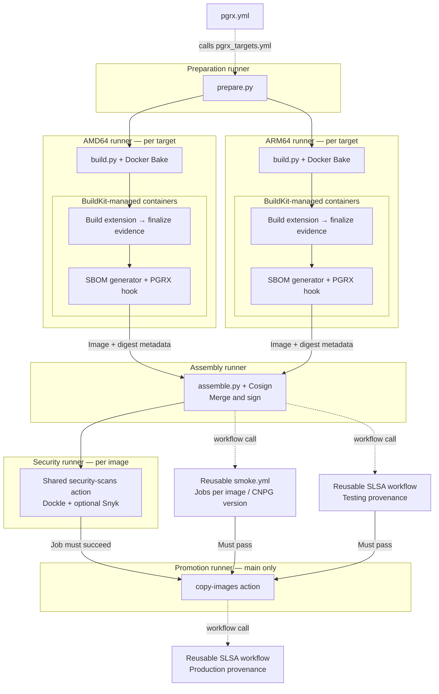

# PGRX extension builds

This project builds Rust-based PostgreSQL extensions from source using PGRX.
Each published image supports AMD64 and ARM64 and includes a software bill of
materials (SBOM), build provenance, and original license notices. Rust compilation
runs on native hardware for each architecture.

To use an extension in CloudNativePG, start with that extension's README for
installation, SQL names, and preload settings. This guide explains how to verify
its image, test a build, and maintain its build recipe.

## Usage

PGRX images use the same SBOM and verification tools as the project's Debian-built
extensions. Their SBOMs also include the Rust dependency graph selected for the
extension. You do not need Rust, cargo-pgrx, or the build tools to inspect a
published image. Scan the PostgreSQL base image separately using its own SBOM.

### Verify images

Follow the SBOM guide to [verify the image and extract its
SBOM](https://github.com/cnpg-extensions/cnpg-sbom-generator#verify-the-image-and-extract-its-sbom),
[inspect and verify build provenance](https://github.com/cnpg-extensions/cnpg-sbom-generator#inspect-and-verify-build-provenance),
and [report vulnerabilities and licenses](https://github.com/cnpg-extensions/cnpg-sbom-generator#report-vulnerabilities-and-licenses).
The tools listed in that guide are sufficient; no PGRX build setup is needed.

For PGRX images published by `cnpg-extensions` from `main`, use this exact
`--certificate-identity` in the guide's Cosign command:

```text
https://github.com/cnpg-extensions/postgres-extensions-containers/.github/workflows/pgrx_targets.yml@refs/heads/main
```

Keep the guide's GitHub Actions OIDC issuer and add
`--new-bundle-format=false` for this repository's legacy-format signatures.
For another publisher, change both the image repository and the exact workflow
identity to that publisher's repository and trusted branch. After copying an
image, verify the destination repository's signature as well.

The guide's extraction examples use a multi-platform index. For a
single-platform index, confirm its platform with `docker buildx imagetools
inspect`, then use `.SBOM.SPDX` and `.Provenance.SLSA` in the format expressions.

PGRX Cargo relationships describe the configured target dependency graph; they
do not claim that every dependency survives linker dead-code elimination.

## How images are built

[`pgrx.yml`](../.github/workflows/pgrx.yml) selects extensions and calls
[`pgrx_targets.yml`](../.github/workflows/pgrx_targets.yml) for each one.
`prepare.py` turns the extension's `metadata.hcl` into a build plan. Each
**target** is one distribution/PostgreSQL combination; each target gets separate
AMD64 and ARM64 jobs on matching native runners.

The boxes below distinguish runner hosts from the containers they launch.
Solid arrows show data flow or required completion. Dashed arrows show reusable
workflow calls, positioned after the jobs they depend on; these calls are
scheduled by GitHub Actions, not made by the Python scripts. Smoke and SLSA
workflows manage their own jobs and runners.



On each native runner, `build.py` checks the architecture before Docker Bake
starts the build. Inside the build containers, the extension's Dockerfile
installs tools, runs the upstream Rust build recipe, finalizes Cargo and license
evidence, and copies runtime files into a minimal `scratch` image. The shared
[SBOM generator](https://github.com/cnpg-extensions/cnpg-sbom-generator#consumer-integration) runs in its own container;
the PGRX hook adds selected Rust packages and license information to its SPDX 2.3
document. BuildKit attaches the SBOM and build provenance to the platform image.

The build jobs push their images to the registry and pass digest metadata through
workflow artifacts. On a separate runner, `assemble.py` combines both platforms
and checks that every image and attestation descriptor survives unchanged.
Cosign signs the assembled index. Later jobs use its immutable digest.

Security, smoke tests, and testing-image SLSA provenance can then run in parallel.
The security runner uses the same shared `security-scans` action as mainline.
Dockle checks image configuration and fails on warnings or errors. When
`SNYK_TOKEN` is configured, Snyk scans the image and uploads findings to GitHub
Code Scanning; the Snyk step is allowed to fail without blocking the job.
This action does not explicitly scan both platform SBOMs or produce Grant
license reports. Both SBOMs remain attached to the image for consumers to scan
against current vulnerability databases using the [verification guide](#verify-images).
Build-time SPDX validation remains in place. The shared smoke workflow tests the
extension in CloudNativePG, and the shared SLSA workflow separately attests the
testing image's build provenance.

Branch builds publish testing images. After all required checks succeed, trusted
`main` push or dispatch events can run the shared `copy-images` action on the
promotion runner. It copies the checked images to production and signs their
digests. A final SLSA workflow call attests the production images in their
destination repositories.

## Development

### Test a complete extension build

For full extension acceptance, dispatch
[`.github/workflows/pgrx.yml`](../.github/workflows/pgrx.yml) with an
`extension_name`. It builds all targets declared in the extension's metadata on
native AMD64 and ARM64 runners, assembles and signs their indexes, checks
SPDX output, runs mainline security checks, and runs CNPG smoke tests. An optional `cnpg_version`
selects `main` or a full version such as `1.30.1`; otherwise the shared support
policy selects the smoke versions. No local signing keys are needed.

Both build families use the shared [smoke workflow](../.github/workflows/smoke.yml)
and test the same CNPG versions: `main`, the highest stable patch of the previous
minor, and the pinned latest release. Smoke uses the standard Task/Dagger setup,
CNPG extension catalogs, and extension installation checks. PGRX supplies the
assembled image digest and selected CNPG release directly. The shared Taskfile
uses live operator manifests and catalogs, including development images for
`main`.

### Try an unsigned local build

Use the extension's ordinary Bake targets with
`-f docker-bake.hcl -f docker-bake-pgrx.hcl -f <extension>/metadata.hcl`
in that order. Supply `build_timestamp` and the digest-qualified `sbom_generator`
from preparation. Select explicit named Bake targets to build a single local
distribution, and restrict the platform to your host's native architecture
(for example, `--set '*.platforms=linux/amd64'` on AMD64). Do not emulate the
other architecture for a Rust build.

The diagnostic `pgrx-sbom` target exports Cargo evidence for inspection. It does
not replace an image build that produces attestations or test hosted signing.

### Local validation

The [PGRX test workflow](../.github/workflows/pgrx-tests.yml) is called by the
PGRX build workflow and can also be dispatched separately. Its contract tests
are required by the `PGRX acceptance` gate; Go tests remain independent.

Both build workflows report their local gates on every pull request,
merge-queue commit, and push to `main`. Discovery selects the extensions to
build; shared changes select the [representative sample](../BUILD.md#usage-and-targets)
on PRs, while only payload changes rebuild automatically on `main`. An empty
selection skips builds explicitly. Failed discovery, contract
tests, or unexpectedly skipped acceptance jobs fail the relevant gate.
Branch protection should require both `Automerge gate` (Debian) and
`PGRX acceptance`. Configure these checks after their first runs; changing the
workflow files does not change repository rules. Mixed Debian/PGRX changes
run both build families without a separate PR-scope policy.
For a working branch without a pull request, dispatch the relevant build workflow.
Use `extension_name=all` to rebuild every extension in that workflow.
PGRX selection mirrors Debian’s `paths-filter` and `jq` steps; discovery uses
`get-targets --build-system pgrx`, with PGRX shared paths and its own sample.

Renovate PGRX source and build-tool updates inherit the shared minor, patch, and
digest auto-merge policy, subject to required checks. Major updates remain manual.
Renovate updates `package` and the adjacent `sql` value together for every PGRX
extension, stripping only a leading `v` from the source tag for SQL. If upstream
ships a different SQL version, investigate the release before merging.

The release acceptance jobs publish testing images and require registry write
and signing permissions. Fork pull requests retain GitHub's read-only token
restrictions; affected builds cannot pass those stages. A maintainer must move
the reviewed changes to a trusted branch and PR in the publishing repository.
Do not bypass the gates or use a privileged pull-request trigger to run fork code.

Run from the repository root with Docker, bash, jq, Python 3, and actionlint available. Run the
downstream suite inside the pinned generator image, matching CI's Syft,
SPDX validator, and composer:

```sh
generator=$(sed -n 's/^ *SBOM_GENERATOR: //p' .github/workflows/pgrx-tests.yml)
test -n "$generator"
docker run --rm --entrypoint python3 \
  --volume "$PWD:/workspace:ro" --workdir /workspace \
  "$generator" pgrx/test.py

# Export YAML using the generator's existing PyYAML, then test the actual shell
# selection steps with the host's bash and jq (also run by the contract workflow).
docker run --rm --entrypoint python3 \
  --volume "$PWD:/workspace:ro" --workdir /workspace \
  "$generator" -c 'import json, pathlib, yaml; print(json.dumps({name: yaml.safe_load(pathlib.Path(f".github/workflows/{file}.yml").read_text()) for name, file in [("debian", "bake"), ("pgrx", "pgrx")]}))' \
  > /tmp/pgrx-selection-workflows.json
python3 pgrx/tests/check_selection.py < /tmp/pgrx-selection-workflows.json

actionlint .github/workflows/bake.yml \
  .github/workflows/bake_targets.yml \
  .github/workflows/pgrx.yml \
  .github/workflows/pgrx_targets.yml \
  .github/workflows/pgrx-tests.yml \
  .github/workflows/cnpg-versions.yml \
  .github/workflows/smoke.yml
```

PGRX tests retain coverage for Rust package selection, licenses, ownership,
shipped files, generator/hook composition, build selection, and native-platform
assembly. Shared Go tests have their own workflow.

The generator source, release workflow, and BuildKit/SPDX/Grype/Grant integration
fixtures are maintained in the [external generator repository](https://github.com/cnpg-extensions/cnpg-sbom-generator).
Both Debian and PGRX builds consume its published `latest` image with an immutable
digest; Renovate groups updates to the workflow pins.

### Add or update an extension recipe

PGRX targets are discovered from `build_system = "pgrx"` in ordinary extension
metadata. `get-targets` defaults to Debian; use `--build-system pgrx` for PGRX
or `--build-system all` for both families. OS-library maintenance excludes PGRX
targets; catalog and testing-value generation support both.

**Start from the [PGRX templates](templates/) and follow their structure.**
The [Dockerfile template](templates/Dockerfile.tmpl) contains the integration
points used by CI, native builds, and SBOM generation. Adapt the source URL,
upstream build commands, dependencies, and copied runtime files for the extension;
keep the shared setup and evidence steps.

For a new extension:

1. Copy and complete the Dockerfile, metadata, and README templates, replacing
   every placeholder and TODO. In metadata, add the canonical `source_repository`
   and literal source tag, including a leading `v` when upstream uses one.
   Set `sql` to the tag without a leading `v`, immediately below `package` so
   Renovate updates both together.
2. Preserve all Dockerfile `ARG` declarations **in their template locations and
   stages**, including `BUILDKIT_SBOM_SCAN_STAGE`, `BASE`, `PG_MAJOR`, `EXT_VERSION`,
   `TARGETARCH`, `TARGETPLATFORM`, the `PGRX_*` identity arguments, and
   `PGRX_BUILD_TIMESTAMP`. They pass CI's selected versions, architecture, source
   identity, and timestamp into the build and evidence tools. Some are consumed
   by helper scripts rather than referenced directly in the Dockerfile. Docker
   arguments are stage-scoped, so retain repeated declarations such as `PG_MAJOR`
   in the final stage too.
3. Keep the stage named `builder`, copy `pgrx/` to `/pgrx/`, and extract the source
   into `/build`. **Call `/pgrx/install-pgrx-build-environment.sh "${PG_MAJOR}"
   /build/Cargo.lock` after extraction and before compilation.** It installs the
   build environment, selects cargo-pgrx from the source lockfile, and prepares
   the SBOM hook and reporting tools.
4. Add the extension to `RECIPES` in [`build_config.py`](build_config.py), matching
   the Dockerfile's manifest path, features, and package/install layout. Add any
   required apt dependencies and keep the upstream recipe URL immediately above
   the build commands.
5. **Call `/pgrx/finalize-pgrx-evidence.sh` after compilation and packaging.** It
   records the completed payload and generates Cargo and license evidence needed
   by the SBOM hook. Preserve the diagnostic `pgrx-sbom` stage and copy the
   generated Rust license notices into the final image alongside the runtime
   files, as the template shows.
6. Declare supported distribution/PostgreSQL combinations in metadata;
   preparation creates their native build jobs automatically. Run the local
   checks and full extension acceptance above. Use the existing SBOM generator
   and hook; do not add a second composer or a build-system-specific consumer
   interface.

In the extension README, explain SQL and catalog names, preload requirements,
and any initialization steps.

#### Recipes with additional runtime needs

Recipes that need additional OS runtime libraries capture base libraries before
installing packages, then stage the packaged extension's additional runtime
closure and copyright notices using the shared helpers. pg-search 0.26.6 uses
LLD and OpenBLAS at build time but does not stage additional runtime libraries.

PostgreSQL Anonymizer declares its GitLab `source_repository` in metadata and
uses the upstream `make extension` target, including runtime CSV data. Payload
evidence includes that data directory recursively. Its catalog preloads `anon`;
initialize its legacy fake-data functions with the mounted data path described
in the extension README.

## Directory guide

Extension-specific Dockerfiles and metadata live at repository root. The main
entrypoints and supporting directories here are:

| File or directory | Purpose |
| --- | --- |
| [`prepare.py`](prepare.py) | Turns extension metadata into native build jobs and Bake definitions. |
| [`assemble.py`](assemble.py) | Combines platform images, preserves attestations, and publishes checked tags. |
| [`build_config.py`](build_config.py) | Registers extension recipes and their Cargo feature selection. |
| [`install-pgrx-build-environment.sh`](install-pgrx-build-environment.sh) | Required Dockerfile setup step: installs build tools and the SBOM hook. |
| [`finalize-pgrx-evidence.sh`](finalize-pgrx-evidence.sh) | Required post-build step: collects Cargo, license, and runtime-payload evidence. |
| [`templates/`](templates/) | Dockerfile, metadata, and README templates to follow for new extensions. |
| [`sbom/`](sbom/) | Hook that adds verified Rust dependencies and licenses to the shared generator's SPDX output. |
| [`dependencies/`](dependencies/) | Rust, rustup, and cargo-about version configuration for extension builders. |
| [`tests/`](tests/) | PGRX tests, run with `python3 pgrx/test.py`. |
