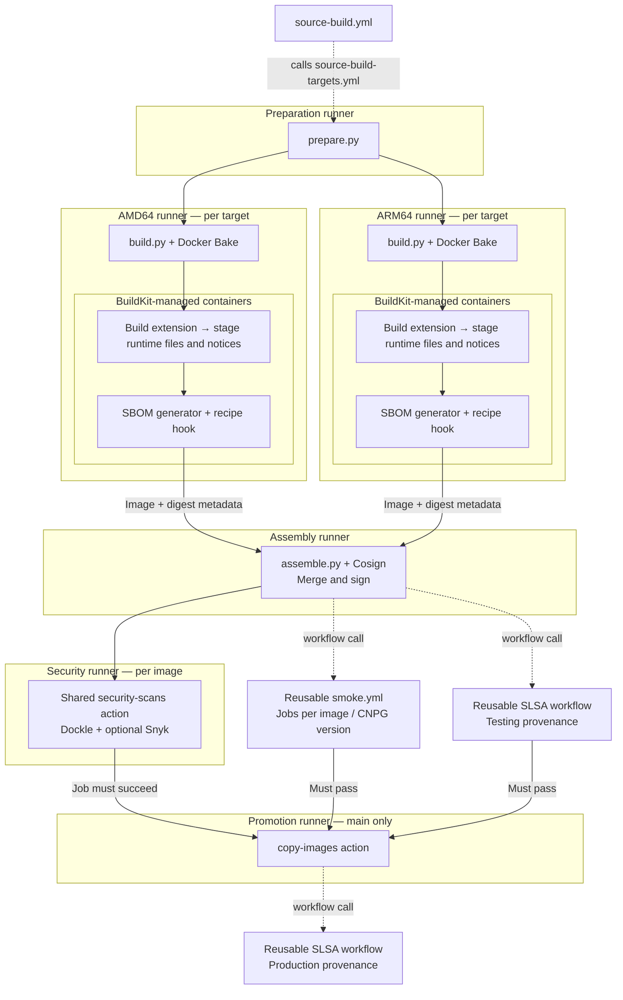

# Source builds

## Inclusion policy: Debian packaging first

Building from source is an exception for toolchain, dependency packaging and
delivery obstacles, not a general alternative to contributing Debian packages.

For extensions whose build tools and dependencies are readily available
in the Debian ecosystem, contributors are expected to package the extension for
Debian. Once packaged, the extension can use this repository's Debian build
path. Absence of a package today, convenience, faster onboarding, or a preference
for Dockerfiles is not sufficient justification for a source build.

The Debian-first policy serves two equally important purposes.

First, community benefit: Debian packaging makes an extension available to a
much wider audience of PostgreSQL users, beyond CloudNativePG. Contributing to
that shared ecosystem is part of being a good citizen of the PostgreSQL
community, and takes precedence over making inclusion here more convenient.

Second, legal compliance and security: preparing software for acceptance in
Debian requires substantial work to identify applicable licenses, collect
copyright and redistribution notices, and untangle dependencies, including
bundled or statically linked components. Dependency identities and versions
must be understood so that maintainers can assess security advisories and
deliver fixes. Our distribution has the same general legal-compliance and
security requirements. A working binary or a custom-built `.deb` alone does not
establish that this work has been done; license identifiers cannot replace
required license texts and notices, and successful installation cannot replace
an inventory of the dependencies actually shipped.

Our experience is that when licensing and dependencies are straightforward to
manage, getting the software packaged for Debian is generally straightforward
too. When Debian packaging is difficult, we commonly discover that the same
underlying blockers also affect our own distribution and adoption in Kubernetes
environments.
Proposals must distinguish packaging or delivery obstacles, and generally
should outline the steps required to complete Debian packaging in the long term.
For an example, see the [pg_duckdb Debian and PGDG inclusion plan](../universe/pg-duckdb/PACKAGING.md#appendix-debian-and-pgdg-inclusion).

For PGRX, the obstacle is the shared build toolchain. `cargo-pgrx` itself
has not yet been accepted into Debian. Packaging has been discussed, but we
cannot plan on near-term availability. This shared toolchain obstacle justifies
building PGRX extensions from source without requiring each extension to solve
Debian packaging independently.

The PGRX framework automates Rust dependency selection, package identities and
versions, license evidence and notice collection, and integration with the shared
SBOM generator. This makes the compliance and dependency-management work
repeatable across PGRX extensions; maintainers still review licensing decisions,
evidence completeness and exceptional dependencies. Automation does not itself
establish legal compliance.

Universe covers other source builds with complex dependency packaging or
delivery obstacles. For pg_duckdb, unresolved Debian/PGDG package ownership,
archive acceptance and backport publication justify an interim source build
while the Debian path is pursued.

The complex dependencies that justify a Universe source build must be exposed at the recipe's documented package
boundaries, with established upstream/ecosystem identities and actual versions.
The pg_duckdb boundary follows Debian DuckDB packaging, including explicit
Debian scanner mappings for source-built counterparts of separately packaged
libraries; it is not an inventory of every internal bundled component.
Where a dependency has standard names or identifiers used to associate CVEs and
other advisories with it, reflect those in the SBOM so future vulnerability records
can be correlated. Use the shared generator's augmentation hook for source-built,
bundled, or statically linked dependency evidence that automatic discovery misses.
The [dependency evidence requirements](#dependency-evidence-in-the-sbom) apply;
an existing CVE is not required.

A Universe proposal must identify the problematic dependencies, their availability
in the relevant Debian ecosystem, and the concrete packaging, maintenance or delivery obstacles that prevent
an installable package set for the required targets. Project maintainers review that rationale in
the proposal/PR; a working Dockerfile alone does not establish eligibility. Keep
the packaging rationale and SBOM overview self-contained in a short `PACKAGING.md`
beside the recipe. Keep the extension README focused on installation and use. If the obstacles are resolved, prefer
transitioning to the Debian path while preserving consumer identities where
possible.

Universe recipes have no equivalent common language toolchain to supply that
evidence. Each recipe requires careful individual review and implementation of
dependency boundaries, actual versions, applicable licenses, attribution and
redistribution notices, and security-relevant identities. Use the shared SBOM
generator and its extension hook for this work, not a separate composer.

The intended selection is Debian packaging for ordinary extensions, the PGRX
toolchain for PGRX extensions, and Universe source builds only for other
extensions with documented complex dependency packaging or delivery obstacles.

## Open Source Licensing Policy

Debian archive acceptance provides the licensing precedent for material shipped
in Debian `main` or `contrib`. Source builds must establish that precedent or
OSI-approved licensing for their selected sources and bundled dependencies.
All build families retain the redistribution obligations below.

All software and other materials distributed in our PostgreSQL extension container images must either be available under an [OSI-approved license](https://opensource.org/licenses) or have already been accepted and shipped in Debian’s `main` or `contrib` archive areas under the same applicable licensing terms.

This requirement covers all distributed material: extensions, libraries, dependencies, utilities, and bundled data in final images. Where Debian acceptance is relied upon, it must cover that material. Build-time dependencies that are not distributed are outside this policy’s scope.

Maintainers may explicitly approve and document an exception for a compelling reason, but exceptions face a high bar and are unlikely.

All images must satisfy applicable license obligations, including copyright notices, attribution, source availability, license compatibility, and redistribution requirements.

## Shared build infrastructure

These utilities prepare and assemble native PostgreSQL extension builds. Recipes
live under `pgrx/<name>` and `universe/<name>`; directory location determines the
build family. Shared tools live here, while Rust-specific tools live in `pgrx/`.

Use the [PGRX recipe instructions](pgrx/README.md) for Rust extensions and the
[Universe recipe instructions](universe/README.md) for other source builds. The
[repository build guide](../BUILD.md) covers the shared Task/Dagger commands.

## How images are built

[`source-build.yml`](../.github/workflows/source-build.yml) selects extensions and calls
[`source-build-targets.yml`](../.github/workflows/source-build-targets.yml) for each one.
`prepare.py` turns the extension's `metadata.hcl` into a build plan. Each
**target** is one distribution/PostgreSQL combination; each target gets separate
AMD64 and ARM64 jobs on matching native runners.

The boxes below distinguish runner hosts from the containers they launch.
Solid arrows show data flow or required completion. Dashed arrows show reusable
workflow calls, positioned after the jobs they depend on; these calls are
scheduled by GitHub Actions, not made by the Python scripts. Smoke and SLSA
workflows manage their own jobs and runners.



On each native runner, `build.py` checks the architecture before Docker Bake
starts the build. Inside the build containers, the extension's Dockerfile
installs tools, runs the upstream build recipe, finalizes source and license
evidence, and copies runtime files into a minimal `scratch` image. The shared
[SBOM generator](https://github.com/cnpg-extensions/cnpg-sbom-generator#consumer-integration) runs in its own container;
the family or recipe hook adds selected source-built packages and license
information to its SPDX 2.3 document. BuildKit attaches the SBOM and build
provenance to the platform image.

The build jobs push their images to the registry and pass digest metadata through
workflow artifacts. On a separate runner, `assemble.py` combines both platforms
and checks that every image and attestation descriptor survives unchanged.
Cosign signs the assembled index. Later jobs use its immutable digest.

Security, smoke tests, and testing-image SLSA provenance can then run in parallel.
Security uses the shared Dockle/optional-Snyk action. The attached platform SBOMs
remain available for consumer vulnerability and license reports through the
[verification guide](../README.md#verify-images).
Build-time SPDX validation remains in place. The shared smoke workflow tests the
extension in CloudNativePG, and the shared SLSA workflow separately attests the
testing image's build provenance.

Branch builds publish testing images. After all required checks succeed, trusted
`main` push or dispatch events can run the shared `copy-images` action on the
promotion runner. It copies the checked images to production and signs their
digests. A final SLSA workflow call attests the production images in their
destination repositories.

The shared `Source-build automerge gate` aggregates discovery, tooling checks
and selected recipe acceptance. Successful releases trigger the existing catalog
refresh; the catalog retains its upstream-first precedence and includes all
three recipe families.

### Shared orchestration and family-specific recipes

PGRX and Universe share metadata discovery, native build preparation, assembly
and release stages. The recipe location determines the family; logical extension
names remain independent of their filesystem paths. Each family has its own Bake
overlay: `docker-bake-pgrx.hcl` or `docker-bake-universe.hcl`, loaded after the
shared `docker-bake.hcl`. Debian keeps its existing packaging path.

Recipes own acquisition, compilation and the final payload. PGRX's Cargo helpers
collect Rust dependency and license evidence; Universe recipes supply their own
component and notice handling. Both augment the same shared SBOM generator.
Runtime libraries, SQL files and notices go into the minimal image, while
build-only tools stay in the builder. The broad `COPY source-build/ /source-build/`
makes shared tools and resources available inside both families' builders.

## Dependency evidence in the SBOM

The final SPDX SBOM must include shipped dependencies at the recipe's documented
package boundaries, including source-built counterparts of separately packaged
Debian libraries that automatic scanning misses. The
[pg_duckdb boundary](../universe/pg-duckdb/PACKAGING.md#sbom-contents) follows
Debian DuckDB packaging: internal bundled code remains covered by its containing
package, complete notices and aggregated license terms. It is not a separate
package inventory of every embedded component. Never suppress actual shipped
Debian binary ownership. A recipe that maps source-built components to Debian
scanner identities must document the mapping, retain actual compiled versions
and source provenance, and distinguish it from dpkg installation or Debian
patch-level claims.
Each separately reported dependency must use its canonical upstream or ecosystem
package name, including the name
used by vulnerability advisories where applicable. This matters even when no CVE
exists today: future advisories should be matchable to the shipped component.
Do not substitute a recipe-local nickname for an established package identity.
Matching still depends on scanner and advisory support. Unknown versions can
broaden scanner matches as well as reduce coverage; missing identifiers can also
limit automated matching.

Use established SPDX fields and Package URL types:

- Record the actual upstream version when known. A source-declared version can
  be a useful, explicit approximation for a fork, as in the PGRX example below.
  When no defensible version is available, omit optional `versionInfo`; do not
  invent versions from repository commits and source paths. Distinguish source
  versions from API compatibility macros.
- Include an accurate standard PURL when the component's ecosystem and source
  support one. Do not guess registry membership, CPEs, versions or identifiers
  merely to satisfy a scanner. Preserve canonical names when a reliable PURL is
  unavailable, and explain unresolved identity evidence in the recipe's packaging notes.
- Express dependency relationships using standard SPDX relationships. Keep
  distinct components distinct, including forks with the same name and version.
- Preserve shipped-file inventory, runtime package ownership, checksums, license
  expressions and original attribution/notices. Use SPDX `LicenseRef` and
  extracted licensing information for terms without an applicable SPDX license
  identifier. Associate required redistribution notices with the standard
  `DISTRIBUTION_ARTIFACT` relationship.

Use the shared generator's existing augmentation hook for missing source-built
components. Evidence must describe the selected sources and final payload;
use recipe build steps and the shared shipped-file inventory to associate them. Builder reports and recipe helpers are
private implementation details, not a second consumer schema. Do not publish
custom JSON annotations, identifier qualifiers, sidecars or attestations as an
alternative API. SPDX identifiers and document namespaces are opaque;
`sourceInfo` is optional human-readable context, not a parseable contract.

Source attribution remains available through recipes, standard source links and
ordinary build provenance where captured. Exact source commit recovery is not a
prerequisite for every build. Tags may move and acquisition may be cached; a
build timestamp alone does not prove which commit a tag selected. Recipes may
resolve commits privately when required to acquire matching nested dependencies.
This does not introduce a new public source-identity contract.


### Example: pg-search's Rust dependencies

The pg-search 0.26.6 dependency graph includes Git forks of published Rust crates.
Their Cargo package names are the identities used by RustSec and OSV advisories;
repository names and dependency aliases are not substitutes. For example, the
pinned Tantivy source declares package `tantivy` version `0.27.0`, so its standard
PURL is `pkg:cargo/tantivy@0.27.0`. The fact that the source comes from ParadeDB's
fork does not change the canonical crate name used for vulnerability matching.

We intentionally use the version declared by the selected source as an
approximation. A fork may include unreleased fixes or changes, so this can yield
false positives or false negatives. Searching Git history for the latest
published ancestor is not necessarily a better approximation: the inspected
Tantivy fork declares `0.27.0`, but the highest stable, non-yanked release with an
ancestor publication commit was `0.19.0`, because later release commits were on
other branches. We preserve useful ecosystem identity without claiming exact
release equivalence or inventing commit-based versions and PURL qualifiers.

The PGRX helpers implement this policy deliberately:

- [`evidence.py`](pgrx/evidence.py) obtains resolved package names and declared
  versions from `cargo metadata`. For selected Git dependencies, it checks that
  the exact name/version exists on crates.io and retains the registry's version
  records as private build evidence. Repeated identities share a lookup. A
  missing release is omitted from these records; registry service errors fail
  the build rather than silently removing PURLs.
- [`augment_spdx.py`](pgrx/sbom/augment_spdx.py) runs offline and emits standard
  Cargo PURLs for crates.io dependencies and the confirmed Git identities.
  Package identity comes from Cargo's package fields, not an alias or repository
  basename. Registry membership confirms an identity, not source equivalence.
- The two Git copies of `superkmeans-rs` both declare `0.3.0`, so both use
  `pkg:cargo/superkmeans-rs@0.3.0`, while retaining separate SPDX components and
  dependency relationships. Unpublished `tantivy-quant` remains named and
  versioned without claiming a crates.io PURL. Workspace packages and alternate
  registries are not automatically mapped to crates.io.

This is PGRX's automatic implementation of the shared evidence principle.
Universe recipes must establish their own ecosystem identities and defensible
versions; the Cargo lookup policy does not apply to DuckDB's dependencies. The
published output remains ordinary SPDX and Package URLs, with no additional
consumer schema or API.

## Local builds

Run from the repository root with Docker/Buildx and Python 3. Use a local registry
so pushed images retain their SBOM and provenance attestations. Select a native
AMD64 or ARM64 Docker-container builder; host, daemon and worker must agree.

Set `SBOM_GENERATOR` to the repository's current digest-qualified shared generator
image. Preparation takes a recipe name and family:

```sh
printf '%s\n' '{"extension_name":"pg-duckdb","build_family":"universe"}' > /tmp/source-inputs.json
GITHUB_RUN_ID=local registry=localhost:5000 \
  python3 source-build/prepare.py --inputs /tmp/source-inputs.json \
  --generator "$SBOM_GENERATOR" --output /tmp/source-prepared
python3 source-build/build.py --architecture amd64 --builder NAME
```

`GITHUB_RUN_ID` is the preparation tool's build identifier; `local` is sufficient
for a local run. Use a fresh output directory for each preparation. The resulting
`preparation.json` lists each distribution/PostgreSQL/platform row and its Bake
file. Choose the row matching the local architecture and intended target:

```sh
docker buildx bake --builder NAME \
  -f /tmp/source-prepared/ROW.json TARGET
```

Use `arm64` for an ARM64 worker. Never compile a source recipe under emulation.
For PGRX, select `build_family=pgrx`; the preparation tool supplies its Rust-specific
arguments. The shared [local smoke-test instructions](../BUILD.md#local-testing-guide)
accept logical names such as `pg-duckdb`. Universe uses the ordinary installation
and version checks; no separate extension-specific runtime suite is required.

## Tooling tests

Run the existing suite in the pinned generator image so its Syft, SPDX validator
and composer match the build environment:

```sh
docker run --rm --entrypoint python3 \
  --volume "$PWD:/workspace:ro" --workdir /workspace \
  "$SBOM_GENERATOR" source-build/test.py
```

The runner discovers both shared and PGRX tests, including preparation, native
assembly and generator/hook composition. Recipe evidence tests should cover lost
packages, identifiers, notices and payload ownership. Universe's evidence is
recipe-specific and must be reviewed when upstream components change.

## Directory guide

| File or directory | Purpose |
| --- | --- |
| [`prepare.py`](prepare.py) | Turns metadata into native build rows and Bake definitions. |
| [`workflow.py`](workflow.py) | Discovers source recipes and their location-derived families. |
| [`build.py`](build.py) | Checks native host, daemon and BuildKit-worker architecture. |
| [`assemble.py`](assemble.py) | Combines platform images and preserves attestations. |
| [`source.py`](source.py) | Shared source-resolution helpers. |
| [`tests/`](tests/) | Shared tooling and recipe-hook tests. |
| [`pgrx/`](pgrx/README.md) | Rust installers, Cargo evidence, SBOM hook, templates and tests. |
| [`universe/`](universe/README.md) | Recipe-authoring guide and templates for Universe builds. |

### Test files

The shared runner and files under `source-build/tests/` are listed below. These
checks use fixtures and mocked external commands; they do not build extensions
or run PostgreSQL.

| Test file | Implementation tested | Coverage |
| --- | --- | --- |
| [`test.py`](test.py) | Runs [`tests/`](tests/) and [`pgrx/tests/`](pgrx/tests/) | Shared entrypoint: discovers both suites, rejects empty PGRX discovery and exits unsuccessfully if any test fails. |
| [`test_discovery.py`](tests/test_discovery.py) | [`workflow.py`](workflow.py) | Location-derived families, recipe boundaries, duplicate names and wrong-family selections. |
| [`test_inputs.py`](tests/test_inputs.py) | [`source.py`](source.py), [`prepare.py`](prepare.py) | GitLab source resolution and architecture-specific base-image selection. |
| [`test_native_builds.py`](tests/test_native_builds.py) | [`prepare.py`](prepare.py), [`build.py`](build.py) | Separate native-platform build definitions and rejection of mismatched host, daemon or worker architectures. |
| [`test_assembly.py`](tests/test_assembly.py) | [`assemble.py`](assemble.py) | Complete platform coverage and preservation of image and attestation descriptors during assembly. |
| [`test_registry.py`](tests/test_registry.py) | [`assemble.py`](assemble.py) | Waiting for the expected registry index digest and rejecting stale or different index contents. |
| [`test_universe_hook.py`](tests/test_universe_hook.py) | [`pg-duckdb/augment_spdx.py`](../universe/pg-duckdb/augment_spdx.py) | pg-duckdb dependency identities, vendor versions, notice preservation, binary associations and preservation of existing SBOM records. |
